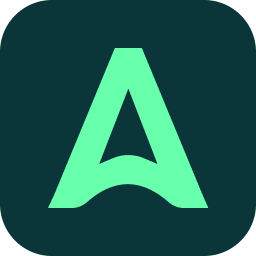

#  Abyssale

Generate images, videos, GIFs, HTML5 banners, and print PDFs from Abyssale designs. Discover workspace templates, categories, projects, and fonts; inspect design layers and multipage content; customize generation settings; retrieve downloadable generated files; create dynamic image URLs; and start asynchronous ZIP exports. Search and optional pagination preserve the original all-results defaults. The connection verifies its API key against the workspace, and credit tools expose actual generation and AI balances. Completion callbacks can be supplied for asynchronous operations.

## License

This integration is licensed under the [FSL-1.1](https://github.com/metorial/metorial-platform/blob/dev/LICENSE).

  Built with ❤️ by <a href="https://metorial.com">Metorial</a>

