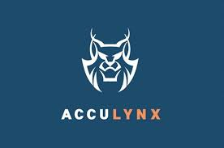

#  AccuLynx

Manage roofing contractor jobs, contacts, estimates, invoices, payments, and appointments with the AccuLynx API. Identify the connected company, search jobs by text or location, list a contact's jobs, read job custom fields, assign representatives, and access insurance details. Retrieve financial worksheets and supplements, record payments and expenses, upload job files, and create or reply to job messages.

Connect with an API key from the [AccuLynx API page](https://my.acculynx.com/apikeys). Each company location needs its own API key. See the [official API reference](https://apidocs.acculynx.com/reference/getjobs) and [integration specification](docs/SPEC.md) for supported workflows.

## License

This integration is licensed under the [FSL-1.1](https://github.com/metorial/metorial-platform/blob/dev/LICENSE).

  Built with ❤️ by <a href="https://metorial.com">Metorial</a>

