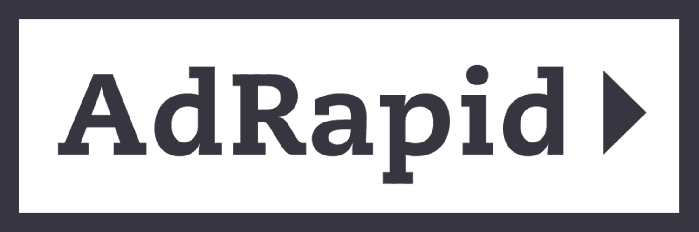

#  Adrapid

Create, search, and retrieve visual marketing assets such as animated banners, images, and videos at scale. Generate banners from templates in multiple formats (PNG, HTML5, PDF, GIF, and video) and sizes automatically. Override template content including text, images, and CSS properties, set a click destination, or create an editable template copy. Poll banner creation status and download completed files. Retrieve account information and enterprise user access URLs for embedded editor integrations.

## License

This integration is licensed under the [FSL-1.1](https://github.com/metorial/metorial-platform/blob/dev/LICENSE).

  Built with ❤️ by <a href="https://metorial.com">Metorial</a>

