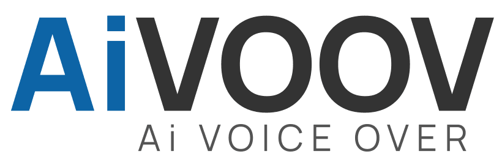

#  Aivoov

Generate spoken audio with multiple voices and per-segment speech controls, browse voices by language, and transcribe audio into downloadable transcripts and SRT subtitles.

Use `list_voices` before `generate_audio`. Audio generation provides a downloadable file and preserves its original `audioBase64` output for existing workflows. The audio format is detected from the returned content; the API does not expose an output-format selector.

For speech recognition, submit Base64-encoded MP3, WAV, FLAC, or OGG audio with `create_transcription`, then poll `get_transcription` using the returned job ID. Completed jobs provide transcript and subtitle downloads. Uploaded audio must be no larger than 10 MB.

Connect with an API key from **My Profile → API**. API access requires an eligible plan and character credit. See the [official text-to-speech API](https://github.com/AiVOOV/aivoov-api) and [speech-to-text API](https://github.com/AiVOOV/aivoov-api/blob/main/speech-to-text-api.md) documentation.

## License

This integration is licensed under the [FSL-1.1](https://github.com/metorial/metorial-platform/blob/dev/LICENSE).

  Built with ❤️ by <a href="https://metorial.com">Metorial</a>

