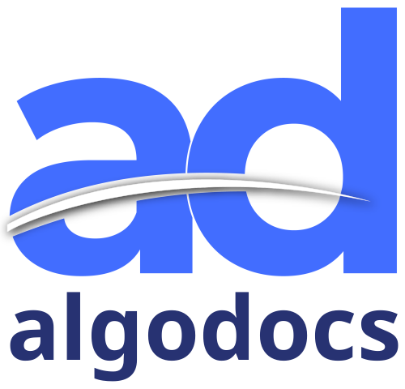

#  AlgoDocs

Connect your AlgoDocs account, discover extractors and folders, upload documents from URLs or base64 content, and retrieve extracted data. Download original documents or available Excel, JSON, XML, TXT, and CSV results.

See [tool details](docs/SPEC.md) and the [official API reference](https://api.algodocs.com/).

## License

This integration is licensed under the [FSL-1.1](https://github.com/metorial/metorial-platform/blob/dev/LICENSE).

  Built with ❤️ by <a href="https://metorial.com">Metorial</a>

