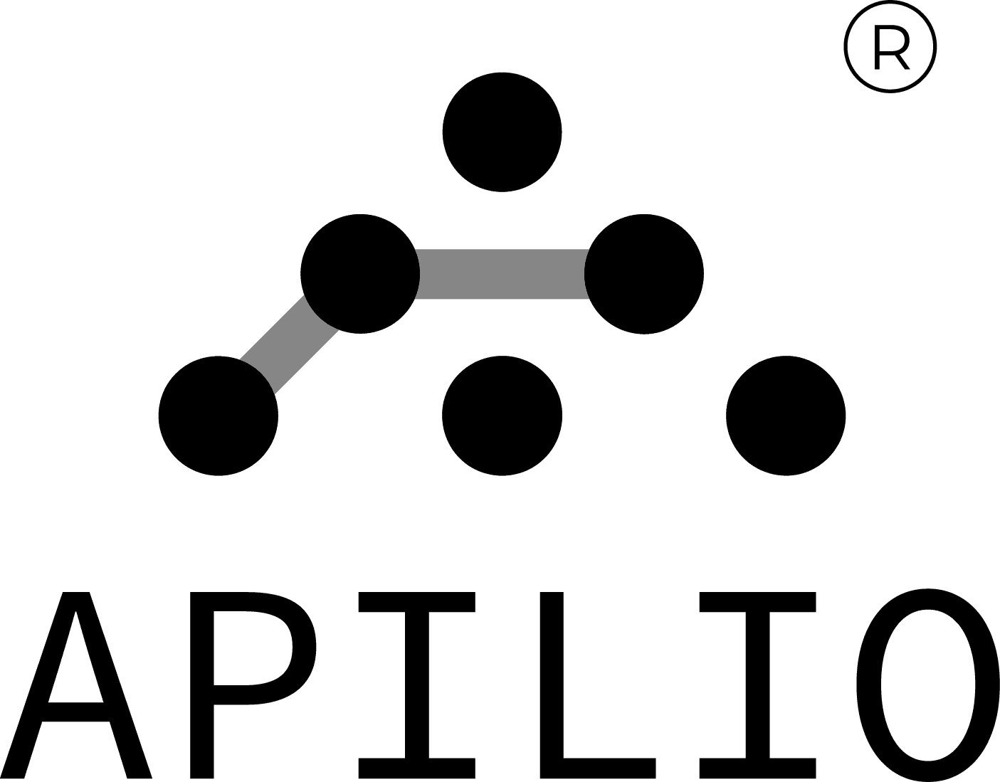

#  Apilio

Read and update existing Apilio boolean, string, and numeric variables; discover variable, time, and Tuya conditions; check condition states; and list, evaluate, activate, or deactivate logicblocks. Coordinate smart home automation through the Apilio REST API.

## License

This integration is licensed under the [FSL-1.1](https://github.com/metorial/metorial-platform/blob/dev/LICENSE).

  Built with ❤️ by <a href="https://metorial.com">Metorial</a>

