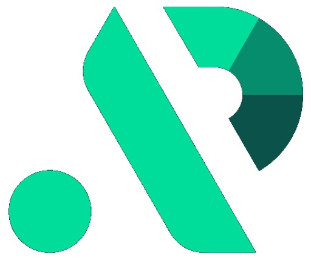

#  APIpie AI

Use APIpie's OpenAI-compatible API to generate chat responses, analyze images, create embeddings, generate downloadable images and speech, search and scrape web pages, manage RAG document collections, discover models and voices, inspect usage, and read or update saved application settings. Model and voice availability varies by provider; use `discover_models` before selecting a model or voice.

Authenticate with an API key from [APIpie](https://apipie.ai/dashboard/profile/api-keys). Optional connection settings select a default provider and routing preference.

## Tools

| Tool | Outcome |
| --- | --- |
| `chat_completion` | Generate text or function calls with optional search, RAG, memory, and routing settings. |
| `analyze_images` | Extract text, answer visual questions, or compare images. |
| `generate_image` | Generate downloadable images while retaining image URLs or base64 output. |
| `text_to_speech` | Generate downloadable speech and available usage metadata. |
| `create_embeddings` | Generate numeric text vectors. |
| `discover_models` | Discover model capabilities, pricing, and voice IDs/names. |
| `web_search` | Search the web, scrape a page, or scrape top search results. |
| `manage_rag` | Upload documents, list collections, or delete collection content. |
| `get_usage` | Inspect paginated request history, tokens, latency, and cost. |
| `get_state` | Read effective application or user settings. |
| `update_state` | Update application settings, remove selected setting keys, or change state feature flags. |

Changing user-state scope clears existing saved configurations. Dashboard-only mode can restrict subsequent API updates. Current official RAG reference documentation is unavailable; existing collection operations remain supported with their existing request contracts.

## License

This integration is licensed under the [FSL-1.1](https://github.com/metorial/metorial-platform/blob/dev/LICENSE).

  Built with ❤️ by <a href="https://metorial.com">Metorial</a>

