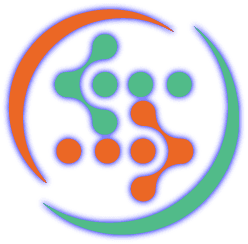

#  Astica Ai

Analyze images, generate images and text, transcribe audio, browse voices and existing private voice clones, and synthesize downloadable speech audio. Low-priority speech tasks can be checked with `get_speech_task` until their WAV audio is ready.

Generated image URLs and speech Base64 values remain available in their existing output fields. Image generation in low-priority mode returns the provider's result URL; its polling format is not documented in the public API reference.

API reference: [Vision](https://astica.ai/vision/documentation/), [Image generation](https://astica.ai/design/documentation/), [Voice](https://astica.ai/voice/documentation/), [Hearing](https://astica.ai/hearing/documentation/), and [Text generation](https://astica.ai/nlp/documentation/).

## License

This integration is licensed under the [FSL-1.1](https://github.com/metorial/metorial-platform/blob/dev/LICENSE).

  Built with ❤️ by <a href="https://metorial.com">Metorial</a>

