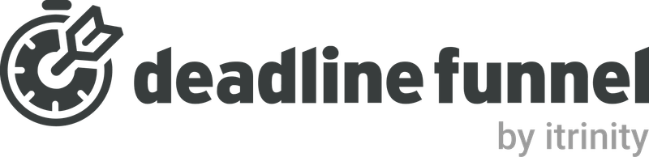

#  Deadline Funnel

Discover campaigns, start personalized deadlines, record purchases, and submit custom events. The **Start Deadline via Custom Webhook** tool uses the campaign-specific webhook documented in Deadline Funnel's [Custom Webhook Integration guide](https://docs.deadlinefunnel.com/en/articles/4429309-custom-webhook-integration).

Copy the custom webhook from the campaign editor under **Emails → Custom API**. Use Deadline Funnel email links in your campaign emails and confirm new tracking records in campaign Analytics.

The existing campaign, deadline, purchase, and custom-event REST operations retain their earlier API-key configuration. The public help center describes these workflows but does not provide a reference for their REST endpoints or response fields; provider acceptance of those routes has not been verified.

## License

This integration is licensed under the [FSL-1.1](https://github.com/metorial/metorial-platform/blob/dev/LICENSE).

  Built with ❤️ by <a href="https://metorial.com">Metorial</a>

