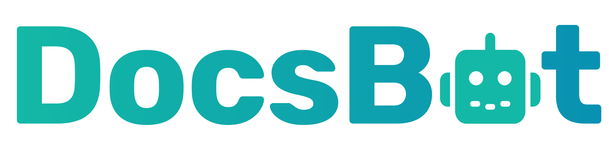

#  DocsBot AI

Create and manage AI chatbots trained on documentation, websites, and uploaded content. Discover accessible teams, inspect team usage and plan limits, manage bots, and monitor training sources. Retry failed sources or update supported source dashboard titles. Ask questions in persistent conversations with image inputs and source citations, rate answers, record question-level support escalations, and inspect question and conversation history.

Connect with a DocsBot user API key. Call `list_teams`, then pass the selected `teamId` to team-scoped tools. Existing connections with a saved team ID continue to work when `teamId` is omitted.

`list_sources` accepts a zero-based `page` and a `limit`, and returns `hasMorePages` and `totalCount`. Use `get_source` to inspect processing warnings, FAQ pairs, indexed URLs, and multi-file ingest progress. `manage_source` supports `retry` for failed sources and `update_title` for URL lists, websites, sitemaps, and multi-file documents.

For document uploads, call `get_upload_url`, upload bytes to its returned URL using PUT, and pass the returned path to `create_source`. Multi-file documents may use an uploaded directory prefix in `fileDir`. The question tool returns completed responses rather than a live token stream.

## License

This integration is licensed under the [FSL-1.1](https://github.com/metorial/metorial-platform/blob/dev/LICENSE).

  Built with ❤️ by <a href="https://metorial.com">Metorial</a>

