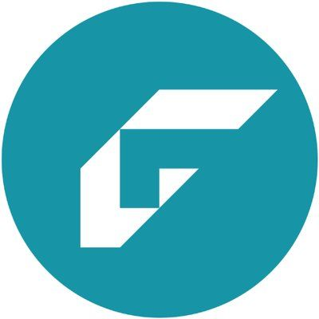

#  Gagelist

Manage measurement equipment, calibration records, manufacturers, account settings, and custom field values in GageList. Discover and download files linked to gages or calibrations, delete files, and generate downloadable calibration certificates.

Connect using the API client ID and client secret issued for your GageList account. `get_account_status` returns the current site, accessible sites, account roles, permissions, usage, and plan limits.

Use `get_gage` or `get_calibration` to discover file IDs, then `get_attachment` to download a file. `update_gage` supports equipment details and calibration scheduling. Custom value writes use exact field names from `get_custom_fields`; specify `recordType` for calibration records and supply `valueIds` when updating existing values.

File uploads are not exposed because the public API documentation omits the request body format. The provider's custom-field-values read article currently shows an unrelated endpoint; the existing read tool remains available, with its route awaiting provider confirmation. BI backup export is a manual account workflow and has no documented API endpoint.

## License

This integration is licensed under the [FSL-1.1](https://github.com/metorial/metorial-platform/blob/dev/LICENSE).

  Built with ❤️ by <a href="https://metorial.com">Metorial</a>

