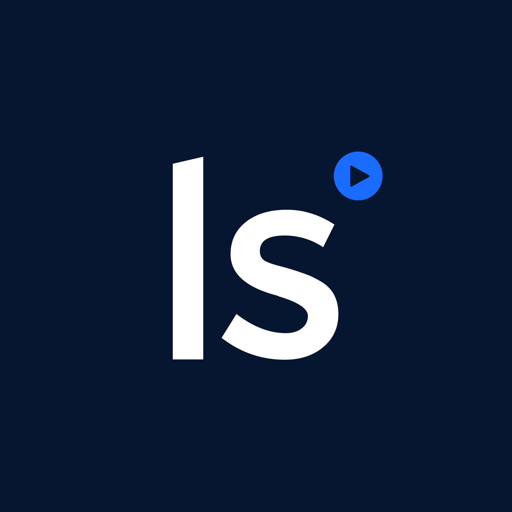

#  Livesession

Access product analytics data from LiveSession. List recorded sessions with replay links, visitor information, geolocation, custom parameters, and event statistics. Create and compute conversion funnels, manage alerts and webhook destinations, discover or create websites, and compute custom-event session metrics as histograms.

Authenticate with a Personal Access Token from LiveSession Settings > API Tokens. Grant the scopes needed for your workflows; the token's website selection determines accessible data.

Funnel compute settings retain their array input and accept one configuration per funnel. Webhook updates can resolve omitted website and URL values when the token has `webhooks:read`. The existing funnel update tool is retained, but the public GraphQL reference currently describes an incompatible update signature; configuration updates depend on provider support for the existing API behavior.

See the [API documentation](https://livesession.dev/docs/api/quickstart) and [integration capabilities](docs/SPEC.md).

## License

This integration is licensed under the [FSL-1.1](https://github.com/metorial/metorial-platform/blob/dev/LICENSE).

  Built with ❤️ by <a href="https://metorial.com">Metorial</a>

