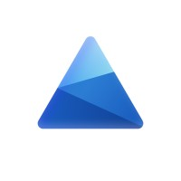

#  Microsoft Clarity

Retrieve Microsoft Clarity dashboard metrics, query traffic and behavioral analytics in natural language, and sample session recordings by date range, URL, device, browser, operating system, and location.

Connect with a project API token from **Settings → Data Export**. Only project admins can generate tokens.

- `get_dashboard_insights` retrieves recent dashboard metrics across up to three dimensions.
- `list_session_recordings` samples recordings for a UTC date range, with optional visitor and page filters.
- `query_analytics_dashboard` asks a focused analytics question with an explicit time range.

The Data Export endpoint is limited to 10 requests per project per day, the preceding 1–3 days, and 1,000 non-paginated rows. Recording samples default to 100 entries and have a maximum of 250.

## License

This integration is licensed under the [FSL-1.1](https://github.com/metorial/metorial-platform/blob/dev/LICENSE).

  Built with ❤️ by <a href="https://metorial.com">Metorial</a>

