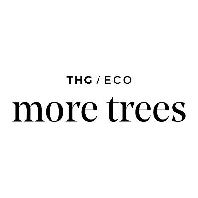

#  More Trees

Plant trees through global reforestation projects. Retrieve account details, credit balances, and forest statistics, browse projects and tree types, and plant trees for yourself or gift them by email or account code. Account codes are supplied when calling account-specific tools; existing connections can keep using their saved account code.

See the [API coverage notes](docs/SPEC.md) for supported workflows and the documentation limits of the retained carbon-offset and key-only credit-balance tools.

## License

This integration is licensed under the [FSL-1.1](https://github.com/metorial/metorial-platform/blob/dev/LICENSE).

  Built with ❤️ by <a href="https://metorial.com">Metorial</a>

