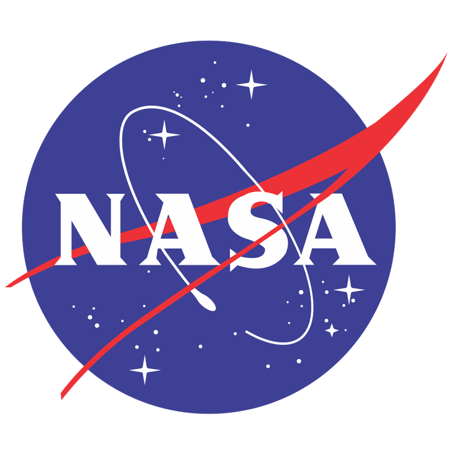

#  NASA

Read NASA astronomy, near-Earth asteroid, EPIC Earth image, natural event, space weather, media, technology project, exoplanet, and solar-system data. Search satellite TLE records through the community service linked by NASA's API catalog. Retrieve downloadable images, media variants, metadata JSON, and video captions while retaining source URLs and scientific metadata.

Connect with a free NASA API key from [api.nasa.gov](https://api.nasa.gov/); `DEMO_KEY` supports limited exploration. All tools are read-only.

NASA marks its legacy Earth and Mars Rover APIs archived; historical availability is not guaranteed. Use `get_apod_entries` for NASA's current APOD service with article permalinks and optional actual media URLs; legacy `get_apod` remains available for compatibility. Use `query_close_approaches` for nullable scientific measurements; the historical `get_close_approaches` tool remains available for compatibility.

See [API coverage, sources, and compatibility notes](docs/SPEC.md).

## License

This integration is licensed under the [FSL-1.1](https://github.com/metorial/metorial-platform/blob/dev/LICENSE).

  Built with ❤️ by <a href="https://metorial.com">Metorial</a>

