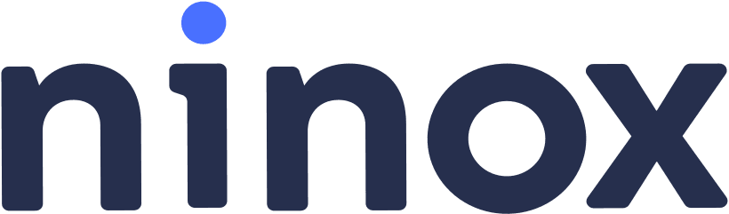

#  Ninox

Discover teams, databases, and table schemas; create, read, update, upsert, and delete records; execute queries and writable scripts; inspect views; track database or table changes; and list, download, or delete record files.

Use a Ninox Personal Access Token from **Ninox Settings → Integrations**. Public Cloud uses `https://api.ninox.com` by default. Supply your instance URL during authentication for Private Cloud or On-Premises, including any port or reverse-proxy path. Existing connections retain their saved endpoint setting. Private Cloud API roles can restrict operations beyond record reads and writes.

## License

This integration is licensed under the [FSL-1.1](https://github.com/metorial/metorial-platform/blob/dev/LICENSE).

  Built with ❤️ by <a href="https://metorial.com">Metorial</a>

