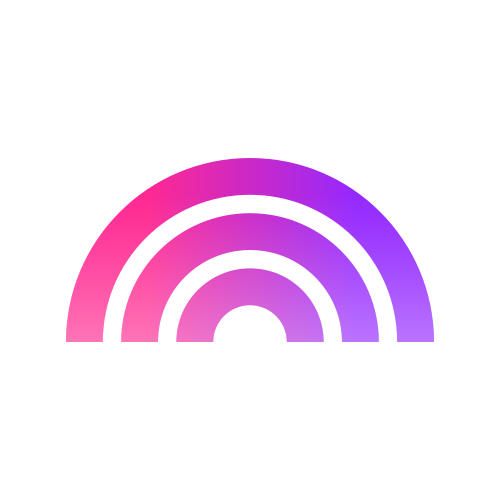

#  Plasmic

Render Plasmic pages and components as HTML, inspect project models, and manage headless CMS content. Discover CMS model identifiers and field definitions, query or retrieve individual entries, count results, create one or multiple entries, update fields, delete entries, and publish drafts. CMS reads support filters, pagination, ordering, localization, and draft content.

Connect project credentials, CMS credentials, or both. Public tokens support reads; secret tokens enable writes and draft CMS reads. Project writes require enterprise access. Project component bodies use the Write API element format, and the Model API is experimental.

## License

This integration is licensed under the [FSL-1.1](https://github.com/metorial/metorial-platform/blob/dev/LICENSE).

  Built with ❤️ by <a href="https://metorial.com">Metorial</a>

