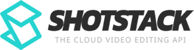

#  Shotstack

Programmatically edit and generate videos, images, and audio using a JSON-based timeline model. Arrange clips with transitions, effects, filters, and overlays. Create reusable templates with merge fields for mass video personalization. Ingest and transform source assets (resize, convert formats, adjust frame rates). Host and distribute rendered assets via CDN or to AWS S3, Google Cloud Storage, Google Drive, Mux, and Vimeo. Generate AI-powered assets including text-to-image, text-to-speech, image-to-video, text generation, talking avatars (D-ID), realistic voice synthesis (ElevenLabs), and Stable Diffusion image generation. Inspect media file metadata such as format, duration, and codecs.

## License

This integration is licensed under the [FSL-1.1](https://github.com/metorial/metorial-platform/blob/dev/LICENSE).

  Built with ❤️ by <a href="https://metorial.com">Metorial</a>

The Edit API generation workflow is available through `list_generation_models`,
`get_generation_model`, `quote_generation`, `generate_media`, and `get_generation`.
A quote estimates credits without creating work; submitting generation can incur
charges. The existing provider-based Create API tools remain available.

Completed render output is temporary and is deleted by Shotstack after 24 hours.
The status tools prepare supported media for download while it is available.
File copying uses a local 64 MiB limit; a failure returns the actual job status
with a delivery warning. Use `get_assets_by_render` or `get_hosted_asset` for
permanent CDN output when Shotstack hosting is enabled.
