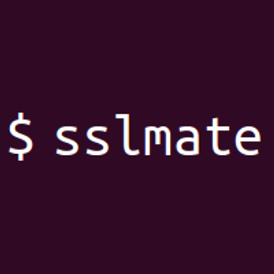

#  Sslmate Cert Spotter API

Monitor Certificate Transparency logs to detect SSL/TLS certificates issued for your domains. Search unexpired certificates by domain name, including subdomains, with deduplication and incremental querying. Expand issuer information and revocation guidance, or request downloadable DER certificates. List monitored domains or retrieve an individual domain's settings, then add, remove, enable, or disable monitoring. Authorize known certificates and public keys to reduce alert noise from legitimate renewals.

## License

This integration is licensed under the [FSL-1.1](https://github.com/metorial/metorial-platform/blob/dev/LICENSE).

  Built with ❤️ by <a href="https://metorial.com">Metorial</a>

